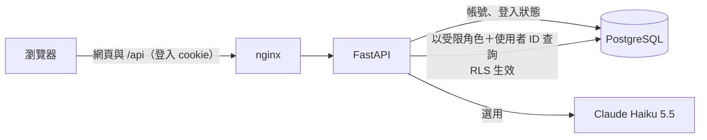

# ThreadsInsight

輸入一個 Threads 帳號，分析它的發文時段、互動分布、內容特徵，並產出內容策略建議的 Web 工具。支援會員登入，每位使用者的分析任務彼此隔離。

> [!IMPORTANT]
> **本專案只使用合成資料（Mock Dataset），不會抓取或顯示任何帳號的真實貼文。**
> 所有貼文由「以帳號名稱為種子」的確定性產生器生成，每篇都標記 `is_synthetic = true`，網址使用無法點擊的 `mock://` 偽協議，報告頂端固定顯示「示範資料」橫幅且不可關閉。為什麼這樣做，請見[資料來源與限制](#資料來源與限制)。

## 線上版

| 網站                | 網址                                                 | 說明                                             |
| :------------------ | :--------------------------------------------------- | :----------------------------------------------- |
| ThreadsInsight      | https://web-production-b6984bbe.up.railway.app       | 用 Email 與密碼註冊即可使用（不需驗證信箱）      |
| 架構圖（Floorplan） | https://floorplan-production-3c17c79e.up.railway.app | 互動式系統架構圖：各部分、檔案說明與三條導覽流程 |

**公開測試帳號**（供大家試用，請勿更改密碼或刪除帳號）：

| Email              | 密碼             |
| :----------------- | :--------------- |
| `demo@example.com` | `demo-test-2026` |

此帳號為共用，任何人都看得到其中的分析任務，請不要輸入個人資料或自己的 Anthropic 金鑰。

兩個網站都部署在 Railway，並與本 repo 的 `main` 分支同步：推上 GitHub 後，Railway 只重新部署有變動的服務（依各服務的監看路徑），資料庫遷移也會自動套用。部署細節見 [docs/architecture.md](docs/architecture.md)。

## 功能

- **會員登入**：Email 與密碼註冊、登入、登出，也能刪除自己的帳號（連同所有分析資料）。未登入者看不到任何頁面內容，API 一律回 `401`。
- **分析任務**：輸入帳號與篇數（1–50 篇），依序執行生成 → 清理 → 三群組分群 → NLP 歸因 → 統計 → 策略建議。任務可檢視、重新執行、刪除；同帳號同篇數 24 小時內直接載入快取。
- **報告**：總覽指標、發文時段與星期分布、熱力圖、文字長度與貼文類型的互動比較、高中低互動群組的內容差異、Top 5 貼文、全部貼文明細。
- **內容策略建議**：規則引擎一定會產出 3 點觀察與改寫範例；有 Anthropic 金鑰時改由 Claude Haiku 5.5 產生（伺服器金鑰，或使用者在網頁輸入自己的金鑰）。
- **多帳號比較**（`/compare`）：勾選 2～4 個已完成任務，並排比較平均互動、互動率、發文頻率、主力貼文長度與最佳貼文類型。
- **匯出**：報告與比較結果都可匯出 CSV（Excel 開啟不亂碼）與 JSON，每列保留合成資料標記。

## 技術架構

| 層級   | 技術                                                                                          |
| :----- | :-------------------------------------------------------------------------------------------- |
| 前端   | Vite+（`vp`）、TypeScript、原生 HTML／CSS（無前端框架）                                       |
| 後端   | Python 3.12、FastAPI、psycopg 3、jieba（繁體詞典）、Anthropic SDK                             |
| 資料庫 | PostgreSQL（Railway），業務資料表以 Row Level Security 隔離                                   |
| 登入   | 自建 Email＋密碼：scrypt 雜湊、httpOnly cookie 保存登入狀態                                   |
| LLM    | Claude Haiku 5.5（`claude-haiku-5-5`），結構化輸出，失敗時退回規則引擎                        |
| 部署   | Railway：nginx（靜態檔、CSP 與安全標頭、轉送 `/api`）＋ FastAPI ＋ Postgres，皆與 GitHub 同步 |



後端查詢業務資料時，會先切換成權限受限的資料庫角色並帶上目前使用者的 ID，看得到哪些資料完全由資料庫的 RLS 規則決定；就算查詢漏寫條件，也拿不到別人的資料。完整的決策與取捨見 [docs/architecture.md](docs/architecture.md)。

## 開發

### 需要安裝

- [uv](https://docs.astral.sh/uv/)（Python）
- [Vite+](https://viteplus.dev/guide/)（`vp`，會依 `package.json` 自動使用 bun）
- 選用：[Docker](https://docs.docker.com/get-docker/)（想在本機跑完整網站時）

### 日常開發

```bash
vp install && uv sync
cp .env.example .env   # 要用 AI 建議時填入 ANTHROPIC_API_KEY（也可以不填，改在網頁輸入自己的金鑰）
```

本機不跑資料庫：日常開發以單元測試為主（資料庫以模擬 RLS 的假實作取代），實際畫面與流程看線上版，或用下方的 docker compose。`.env` 已列在 `.gitignore`，請勿提交。

### 在本機跑完整網站（選用）

```bash
docker compose up --build
```

會啟動 Postgres、資料庫遷移、API 與網站，打開 http://localhost:8080 註冊一個帳號即可使用。停止：`docker compose down`（加 `-v` 連同資料一起刪除）。

## 環境變數

| 變數                            | 用途                                                                          |
| :------------------------------ | :---------------------------------------------------------------------------- |
| `DATABASE_URL`                  | PostgreSQL 連線字串。Railway 由平台提供；docker compose 會自動設定            |
| `COOKIE_SECURE`                 | 登入 cookie 是否只在 HTTPS 送出，預設 `true`；本機 http 開發時設 `false`      |
| `ANTHROPIC_API_KEY`             | 選填。伺服器端的 Anthropic 金鑰                                               |
| `THREADSINSIGHT_AI`             | `auto`（預設，有金鑰才啟用）、`on`、`off`（一律停用，連網頁輸入的金鑰也不用） |
| `LOG_FORMAT`                    | `json`（預設，一行一筆）或 `text`                                             |
| `LOCAL_DB_PASSWORD`、`WEB_PORT` | 只有 docker compose 會用到，預設值即可（見 `.env.example`）                   |

## 專案結構

```text
api/threadsinsightapi/   FastAPI：合成資料生成、清理、分群、NLP、統計、策略、會員登入、任務管理
api/tests/               pytest（不連網路、不連資料庫：資料庫與 Anthropic 都以假實作取代）
src/                     前端：main.ts（分析）、login.ts（登入）、compare.ts（比較）
  api/  auth/  compare/  ui/  export/  analysis/  mock/
db/migrations/           資料表、RLS 規則、Mock Dataset 約束、交易式寫入函式
e2e/                     Playwright：對線上版（或 E2E_BASE_URL）跑完整使用流程
shared/                  前後端共用的合成內容庫與跨語言 golden 檔
data/                    範例合成資料（`vp run samples` 產生）
reports/                 範例分析報告：Markdown（含 2 張圖）與完整 JSON
docker/                  Dockerfile、資料庫遷移腳本與 nginx 設定（CSP、安全標頭）
docs/                    開發文件（目錄見 docs/README.md）：PRD、API 規格、架構決策、資料表說明、設計稿、考題對照
docs/floorplan/          架構圖匯出檔（線上架構圖網站的內容）
AI_LOG.md                AI 協作開發紀錄
```

## 測試與檢查

```bash
vp check          # 前端格式、lint、型別檢查
vp test           # 前端單元測試
vp run api:test   # 後端 pytest 與覆蓋率
uv run ruff check api
vp run e2e        # Playwright E2E，對線上版執行
vp run e2e:local  # 對本機 docker compose（http://localhost:8080）執行
vp run build      # 建置三個頁面
vp run clean      # 清除建置與測試快取（加 --dry-run 只列出不刪除）
```

單元測試不連資料庫，也不呼叫付費 API：資料庫存取以記憶體版 Repository 模擬 RLS，Anthropic client 以假實作注入。

E2E 測試的注意事項：

- 第一次使用要下載瀏覽器：`vpx playwright install chromium`；或設定 `E2E_BROWSER_CHANNEL=chrome` 改用本機的 Chrome。
- 每個測試會建立一個 `e2e-…@example.com` 帳號，結束時透過「刪除自己的帳號」清掉，不留資料。
- 每個測試都會自動檢查頁面沒有 JavaScript 錯誤與 CSP 違規。失敗時的截圖與 trace 在 `test-results/`，報告在 `playwright-report/`。
- 線上版沒有設定伺服器端的 AI 金鑰，測試也不輸入金鑰，因此不會產生 AI 費用。

## 日誌

後端日誌預設為一行一筆 JSON（`LOG_FORMAT=text` 改成較好讀的文字格式），每筆都有 `request_id`，與回應標頭 `X-Request-ID` 相同，可用來對照使用者回報的問題。

| 事件             | 內容                                                          |
| :--------------- | :------------------------------------------------------------ |
| `http.request`   | 方法、路徑（不含查詢字串）、狀態碼、耗時                      |
| `task.completed` | 任務 ID、帳號、**生成種子**、篇數、生成／分析／寫入各階段耗時 |
| `task.failed`    | 失敗的階段、例外類型、已完成階段的耗時                        |
| `llm.call`       | 模型、狀態（success、timeout、refusal 等）、耗時、token 用量  |
| `auth.*`         | 註冊、登入、登入失敗、刪除帳號（只記使用者 ID）               |

密碼、登入 cookie、金鑰、Email 與貼文內文一律不寫入日誌。

## 分析指標定義

| 指標                | 怎麼算                                                                                                                                                                                 |
| :------------------ | :------------------------------------------------------------------------------------------------------------------------------------------------------------------------------------- |
| 互動數              | 讚 + 回覆 + 轉發                                                                                                                                                                       |
| 加權互動分          | 讚 + 2 × 回覆。回覆比按讚更費力，所以加倍計算；Top 5 貼文與高／中／低分群都用它排序                                                                                                    |
| 互動率              | 互動數 ÷ 瀏覽數，只用有公開瀏覽數的貼文計算；瀏覽數未公開的貼文顯示「未公開」。因為部分貼文沒有瀏覽數，且瀏覽少的貼文互動率容易虛高，所以排名不用互動率                                |
| 高／中／低互動組    | 依加權互動分排序，前 30% 為高、後 30% 為低、其餘為中；同分的貼文一律分在同一組。少於 10 篇時標示「小樣本，僅供參考」                                                                   |
| 發文時間分布        | 換算成台灣時間（UTC+8）後，統計星期幾、幾點發文的篇數（熱力圖）                                                                                                                        |
| 文字長度            | 去除網址與空白後的字數，分成 0–50、51–100、101–200、201–400、401 以上五個區間，比較各區間的平均互動數                                                                                  |
| 貼文類型            | 每篇只歸一類，優先順序：含圖片 > 含連結 > 含 hashtag > 含 mention > 純文字                                                                                                             |
| 常見關鍵字／hashtag | 以「出現在幾篇貼文」計數，各取前 10 名；關鍵字用 jieba 繁體詞典斷詞，並排除停用詞                                                                                                      |
| 策略觀察            | 在發文時段、貼文類型、主題、字數、是否提問、是否用 hashtag、是否附連結等面向，找出平均互動數和整體差距最大的 3 點；每組至少要有足夠篇數、差距至少 10% 才列出，屬相關性觀察，不代表因果 |

更細的規則（例如 hashtag、mention 的判斷方式）見 [docs/api-spec.md](docs/api-spec.md) 第 2.1 節。

範例資料與報告在 [data/](data/) 和 [reports/](reports/)，可用 `vp run samples` 重新產生（預設 `demo_user` 30 篇；也可指定帳號與篇數，例如 `vp run samples another_demo --count 50`）。

## 資料來源與限制

### 為什麼不用真實貼文

開發前（2026-11-19）實測過各種取得公開貼文的方式，結果如下：

| 測試方式                                                             | 實測結果                                                 | 結論                                         |
| :------------------------------------------------------------------- | :------------------------------------------------------- | :------------------------------------------- |
| 直接讀取個人頁 HTML（未登入）                                        | 回傳 HTTP 200，但頁面內嵌貼文為 0 篇                     | 無法透過靜態 HTML 解析取得貼文               |
| GraphQL `BarcelonaProfileThreadsTabRefetchableDirectQuery`（未登入） | 第一頁請求即遭擋並回傳 HTTP 401                          | 未登入狀態無法存取公開貼文 API               |
| 瀏覽器自動化擷取工具（Playwright 等）                                | 觸發登入驗證牆，無法擷取載入貼文的請求                   | 用帳號登入後爬取有違反平台服務條款與封號風險 |
| Meta / Threads 官方 Graph API                                        | 申請流程受限，且 API 規範僅允許讀取 Token 擁有者自身帳號 | 無法用於分析任意輸入的公開 Threads 帳號      |

因此本專案**一律使用確定性合成資料**，不以任何已登入的帳號工作階段爬取資料。

### 合成資料的規則

- **整批與逐筆標示**：任務標記 `data_source = 'mock_dataset'`，每篇貼文 `is_synthetic = true`，匯出檔也保留這兩個欄位。
- **不偽造網址、不冒用內容**：網址一律是 `mock://threads/@{username}/post/{n}`；內文取自通用主題庫，不模仿任何帳號的語氣。
- **可重現**：以正規化後的帳號為亂數種子，同帳號每次結果完全相同；較少篇數的結果是較多篇數的前綴。
- **互動層級分明**：每 10 篇固定 3 高、4 中、3 低互動，讓三群組歸因有意義；少於 10 篇時標示為小樣本。
- **資料庫層防護**：上述規則寫成資料庫約束，不符合的資料（例如真實 threads.com 網址、`is_synthetic = false`）無法寫入。

### 這代表什麼

- 報告中的數字**不代表任何真實帳號的表現**，只用來展示分析流程與介面。
- 帳號名稱只作為亂數種子；輸入真實存在的帳號也不會取得或推測其內容。
- 完整規則見 [docs/api-spec.md](docs/api-spec.md) 第 4、5 節。

## 安全設計

- **資料隔離**：三張業務資料表都啟用 RLS。後端每個交易先切換成受限角色 `threadsinsight_app` 並帶上使用者 ID，政策只放行本人的資料；這個角色碰不到帳號與密碼表。寫入結果的資料庫函式以呼叫者身分執行，RLS 照常生效。
- **登入**：密碼以 scrypt 加鹽雜湊保存；登入狀態放在 `HttpOnly`、`Secure`、`SameSite=Strict` 的 cookie，資料庫只存它的 SHA-256，登出或刪帳號時在伺服器端作廢。登入失敗一律回同一個訊息，不透露帳號是否存在。
- **跨站請求**：會修改資料的請求若帶著其他網站的 Origin，一律拒絕（403）。
- **金鑰處理**：使用者在網頁輸入的 Anthropic 金鑰只存在該分頁的 `sessionStorage`，以標頭送出，不寫入資料庫、日誌或網址；伺服器金鑰只放在環境變數，不進映像檔。
- **網頁防護**：嚴格 CSP（不允許行內腳本、樣式與 `eval`，只能連回自己的網站）、`X-Frame-Options: DENY`、`nosniff`、`Referrer-Policy`、`Permissions-Policy`；所有動態文字經過跳脫；CSV 匯出防公式注入；登入後的導向只接受站內路徑。
- **限流**：註冊與登入每個 IP 每分鐘 30 次；建立／重跑任務每位使用者每分鐘 30 次，實際呼叫 AI 每分鐘 10 次。

## 已知限制

- **不驗證信箱、沒有忘記密碼**：沒有寄信服務，註冊後直接啟用帳號，也無法用 Email 重設密碼；要開放給外部使用者前，應接上寄信服務並補上這兩項功能。
- **限流在單一程序內**：多台伺服器或重啟後不共用。
- **尚未加上 HSTS**：線上版走 Railway 提供的 HTTPS 網域，HSTS 標頭待確定正式網域後再加上。
- **E2E 只測 Chromium**：Firefox、Safari 尚未納入。

## 相關文件

開發文件都放在 [docs/](docs/)，從 [docs/README.md](docs/README.md) 開始看最快。

- [docs/exam.md](docs/exam.md)：考題、開發時間表與考題要求逐項對照
- [docs/prd.md](docs/prd.md)：產品需求文件
- [docs/api-spec.md](docs/api-spec.md)：API 端點、欄位定義與 Mock Dataset 規則
- [docs/architecture.md](docs/architecture.md)：架構決策紀錄（資料庫、登入、任務管理、比較頁、部署）
- [docs/schema.md](docs/schema.md)：資料表說明
- [docs/design.md](docs/design.md)：視覺設計稿
- [AI_LOG.md](AI_LOG.md)：AI 協作開發紀錄
