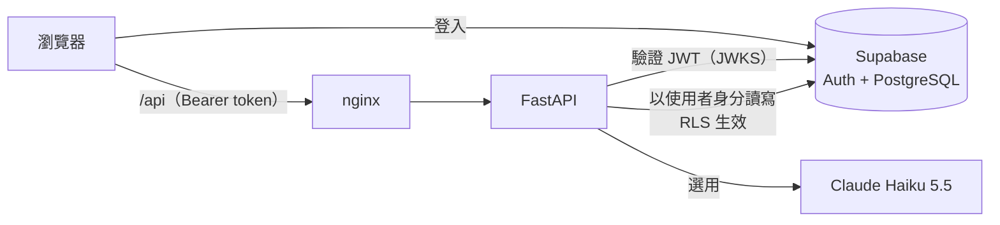

# ThreadsInsight

輸入一個 Threads 帳號，分析它的發文時段、互動分布、內容特徵，並產出內容策略建議的 Web 工具。支援會員登入，每位使用者的分析任務彼此隔離。

> [!IMPORTANT]
> **本專案只使用合成資料（Mock Dataset），不會抓取或顯示任何帳號的真實貼文。**
> 所有貼文由「以帳號名稱為種子」的確定性產生器生成，每篇都標記 `is_synthetic = true`，網址使用無法點擊的 `mock://` 偽協議，報告頂端固定顯示「示範資料」橫幅且不可關閉。為什麼這樣做，請見[資料來源與限制](#資料來源與限制)。

## 功能

- **會員登入**：Email／密碼或 Magic Link（Supabase Auth）。未登入者看不到任何頁面內容，API 一律回 `401`。
- **分析任務**：輸入帳號與篇數（1–50 篇），依序執行生成 → 清理 → 三群組分群 → NLP 歸因 → 統計 → 策略建議。任務可檢視、重新執行、刪除；同帳號同篇數 24 小時內直接載入快取。
- **報告**：總覽指標、發文時段與星期分布、熱力圖、文字長度與貼文類型的互動比較、高中低互動群組的內容差異、Top 5 貼文、全部貼文明細。
- **內容策略建議**：規則引擎一定會產出 3 點觀察與改寫範例；有 Anthropic 金鑰時改由 Claude Haiku 5.5 產生（伺服器金鑰，或使用者在網頁輸入自己的金鑰）。
- **多帳號比較**（`/compare`）：勾選 2～4 個已完成任務，並排比較平均互動、互動率、發文頻率、主力貼文長度與最佳貼文類型。
- **匯出**：報告與比較結果都可匯出 CSV（Excel 開啟不亂碼）與 JSON，每列保留合成資料標記。

## 技術架構

| 層級     | 技術                                                                                     |
| :------- | :--------------------------------------------------------------------------------------- |
| 前端     | Vite+（`vp`）、TypeScript、原生 HTML／CSS（無前端框架）、supabase-js                     |
| 後端     | Python 3.12、FastAPI、jieba（繁體詞典）、Anthropic SDK                                   |
| 資料庫   | Supabase：Auth、PostgreSQL、Row Level Security；本機以 Supabase CLI 執行                 |
| LLM      | Claude Haiku 5.5（`claude-haiku-5-5`），結構化輸出，失敗時退回規則引擎                   |
| 本機部署 | docker compose：nginx（靜態檔、CSP 與安全標頭、轉送 `/api`）＋ FastAPI，皆以非 root 執行 |



後端以「使用者自己的登入憑證」存取資料庫，看得到哪些資料完全由 RLS 決定，後端不持有任何 Supabase 密鑰。完整的決策與取捨見 [docs/architecture.md](docs/architecture.md)。

## 快速開始

### 需要安裝

- [Docker](https://docs.docker.com/get-docker/)（Supabase CLI 與 docker compose 都需要）
- [Supabase CLI](https://supabase.com/docs/guides/local-development/cli/getting-started)
- 用開發模式時另外需要：[uv](https://docs.astral.sh/uv/)（Python）、[Vite+](https://viteplus.dev/guide/)（`vp`，會依 `package.json` 自動使用 bun）

### 1. 啟動本機 Supabase

```bash
supabase start -x realtime,storage-api,imgproxy,edge-runtime,logflare,vector,supavisor
```

`-x` 排除用不到的服務，可以少下載很多映像檔。第一次啟動會自動建立資料表與 RLS 規則（`supabase/migrations/`）。

| 服務                  | 網址                   |
| :-------------------- | :--------------------- |
| Studio（資料庫管理）  | http://127.0.0.1:54323 |
| Mailpit（本機收信箱） | http://127.0.0.1:54324 |

Magic Link 的信會寄到 Mailpit，不會寄到真的信箱。

### 2. 建立設定檔

```bash
cp .env.example .env
```

本機 Supabase 的預設值已經填好，不用修改就能啟動。要用 AI 建議時填入 `ANTHROPIC_API_KEY`（也可以不填，改在網頁上輸入自己的金鑰）。`.env` 已列在 `.gitignore`，請勿提交。

### 3A. 用 docker compose 啟動（建議）

```bash
docker compose up --build
```

打開 http://localhost:8080 ，註冊一個帳號即可開始使用。停止：`docker compose down`。

### 3B. 用開發模式啟動

```bash
vp install && uv sync
vp run api:dev   # 終端機 1：FastAPI，http://127.0.0.1:8000
vp dev           # 終端機 2：前端，http://localhost:5173（/api 會轉送到 8000）
```

停止 Supabase：`supabase stop`（資料會保留）。

## 環境變數

| 變數                                                     | 用途                                                                                  |
| :------------------------------------------------------- | :------------------------------------------------------------------------------------ |
| `SUPABASE_URL`                                           | 後端連 Supabase 的網址（驗證 JWT、存取資料庫）                                        |
| `SUPABASE_PUBLISHABLE_KEY`                               | 後端呼叫 PostgREST 用的 publishable key；未設定時改讀 `VITE_SUPABASE_PUBLISHABLE_KEY` |
| `VITE_SUPABASE_URL`、`VITE_SUPABASE_PUBLISHABLE_KEY`     | 打包進前端，**只能放 publishable key**（`sb_publishable_` 開頭），絕不可放 secret key |
| `ANTHROPIC_API_KEY`                                      | 選填。伺服器端的 Anthropic 金鑰                                                       |
| `THREADSINSIGHT_AI`                                      | `auto`（預設，有金鑰才啟用）、`on`、`off`（一律停用，連網頁輸入的金鑰也不用）         |
| `SUPABASE_JWT_ISSUER`、`DOCKER_SUPABASE_URL`、`WEB_PORT` | 只有 docker compose 會用到，預設值即可（見 `.env.example`）                           |

## 專案結構

```text
api/threadsinsightapi/   FastAPI：合成資料生成、清理、分群、NLP、統計、策略、登入驗證、任務管理
api/tests/               pytest（不連網路：Supabase 與 Anthropic 都以假實作取代）
src/                     前端：main.ts（分析）、login.ts（登入）、compare.ts（比較）
  api/  auth/  compare/  ui/  export/  analysis/  mock/
supabase/migrations/     資料表、RLS 規則、Mock Dataset 約束、交易式寫入函式
supabase/tests/          pgTAP：RLS 隔離與約束測試
shared/                  前後端共用的合成內容庫與跨語言 golden 檔
docker/                  Dockerfile 與 nginx 設定（CSP、安全標頭）
docs/architecture.md     架構決策紀錄（ADR-001）
threadsinsightapi.md     API 與 Mock Dataset 規格書
threadsinsight_prd-1.md  產品需求文件
```

## 測試與檢查

```bash
vp check          # 前端格式、lint、型別檢查
vp test           # 前端單元測試
vp run api:test   # 後端 pytest 與覆蓋率
uv run ruff check api
supabase test db  # RLS 與資料庫約束（需先 supabase start）
vp run e2e        # Playwright E2E（需先 supabase start；會自動啟動 API 與前端）
vp run e2e:docker # 對 docker compose（http://localhost:8080）跑 E2E，並檢查 CSP 與安全標頭
vp run build      # 建置三個頁面
vp run clean      # 清除建置與測試快取（加 --dry-run 只列出不刪除）
```

測試不會呼叫付費 API：單元測試以假實作取代 Anthropic client 與資料庫；E2E 測試關閉 AI（`THREADSINSIGHT_AI=off`）。

E2E 測試的注意事項：

- 第一次使用要下載瀏覽器：`vpx playwright install chromium`；或設定 `E2E_BROWSER_CHANNEL=chrome` 改用本機的 Chrome。
- 每個測試會建立一個 `e2e-…@example.com` 帳號，全部結束後自動刪除（只會刪除本機 Supabase 上的帳號）。
- 每個測試都會自動檢查頁面沒有 JavaScript 錯誤與 CSP 違規。失敗時的截圖與 trace 在 `test-results/`，報告在 `playwright-report/`。

## 日誌

後端日誌預設為一行一筆 JSON（`LOG_FORMAT=text` 改成較好讀的文字格式），每筆都有 `request_id`，與回應標頭 `X-Request-ID` 相同，可用來對照使用者回報的問題。

| 事件             | 內容                                                          |
| :--------------- | :------------------------------------------------------------ |
| `http.request`   | 方法、路徑（不含查詢字串）、狀態碼、耗時                      |
| `task.completed` | 任務 ID、帳號、**生成種子**、篇數、生成／分析／寫入各階段耗時 |
| `task.failed`    | 失敗的階段、例外類型、已完成階段的耗時                        |
| `llm.call`       | 模型、狀態（success、timeout、refusal 等）、耗時、token 用量  |

登入憑證、金鑰、Email 與貼文內文一律不寫入日誌。

## 資料來源與限制

### 為什麼不用真實貼文

開發前（2026-11-19）實測過各種取得公開貼文的方式，結果如下：

| 測試方式                                                             | 實測結果                                                 | 結論                                         |
| :------------------------------------------------------------------- | :------------------------------------------------------- | :------------------------------------------- |
| 直接讀取個人頁 HTML（未登入）                                        | 回傳 HTTP 200，但頁面內嵌貼文為 0 篇                     | 無法透過靜態 HTML 解析取得貼文               |
| GraphQL `BarcelonaProfileThreadsTabRefetchableDirectQuery`（未登入） | 第一頁請求即遭擋並回傳 HTTP 401                          | 未登入狀態無法存取公開貼文 API               |
| 瀏覽器自動化擷取工具（Playwright 等）                                | 觸發登入驗證牆，無法擷取載入貼文的請求                   | 用帳號登入後爬取有違反平台服務條款與封號風險 |
| Meta / Threads 官方 Graph API                                        | 申請流程受限，且 API 規範僅允許讀取 Token 擁有者自身帳號 | 無法用於分析任意輸入的公開 Threads 帳號      |

因此本專案**一律使用確定性合成資料**，不以任何已登入的帳號工作階段爬取資料。

### 合成資料的規則

- **整批與逐筆標示**：任務標記 `data_source = 'mock_dataset'`，每篇貼文 `is_synthetic = true`，匯出檔也保留這兩個欄位。
- **不偽造網址、不冒用內容**：網址一律是 `mock://threads/@{username}/post/{n}`；內文取自通用主題庫，不模仿任何帳號的語氣。
- **可重現**：以正規化後的帳號為亂數種子，同帳號每次結果完全相同；較少篇數的結果是較多篇數的前綴。
- **互動層級分明**：每 10 篇固定 3 高、4 中、3 低互動，讓三群組歸因有意義；少於 10 篇時標示為小樣本。
- **資料庫層防護**：上述規則寫成資料庫約束，不符合的資料（例如真實 threads.com 網址、`is_synthetic = false`）無法寫入。

### 這代表什麼

- 報告中的數字**不代表任何真實帳號的表現**，只用來展示分析流程與介面。
- 帳號名稱只作為亂數種子；輸入真實存在的帳號也不會取得或推測其內容。
- 完整規則見 [threadsinsightapi.md](threadsinsightapi.md) 第 4、5 節。

## 安全設計

- **資料隔離**：四張業務資料表全部啟用 RLS，只允許本人存取，`anon` 角色沒有任何權限；寫入結果使用 `security invoker` 函式，RLS 照常生效。
- **登入驗證**：後端以 JWKS 驗證 Supabase access token，只接受非對稱演算法（ES256／RS256），並檢查 issuer、audience、到期時間與角色。
- **金鑰處理**：使用者在網頁輸入的 Anthropic 金鑰只存在該分頁的 `sessionStorage`，以標頭送出，不寫入資料庫、日誌或網址；伺服器金鑰只放在 `.env`，不進映像檔。
- **網頁防護**：嚴格 CSP（不允許行內腳本、樣式與 `eval`）、`X-Frame-Options: DENY`、`nosniff`、`Referrer-Policy`、`Permissions-Policy`；所有動態文字經過跳脫；CSV 匯出防公式注入；登入後的導向只接受站內路徑。
- **限流**：建立／重跑任務每位使用者每分鐘 30 次，實際呼叫 AI 每分鐘 10 次。

## 已知限制

- **只支援本機部署**：雲端平台（Vercel Python Functions 或 Railway）尚未決定；AI 端點最壞約 95 秒，需先確認平台的執行時間上限。部署到 HTTPS 時需加上 HSTS。
- **限流在單一程序內**：多台伺服器或重啟後不共用。
- **E2E 只測 Chromium**：Firefox、Safari 尚未納入。

## 相關文件

- [docs/architecture.md](docs/architecture.md)：架構決策紀錄（資料庫、登入、任務管理、比較頁、部署）
- [threadsinsightapi.md](threadsinsightapi.md)：API 端點、欄位定義與 Mock Dataset 規則
- [threadsinsight_prd-1.md](threadsinsight_prd-1.md)：產品需求文件
- [AI_LOG.md](AI_LOG.md)：AI 協作開發紀錄
