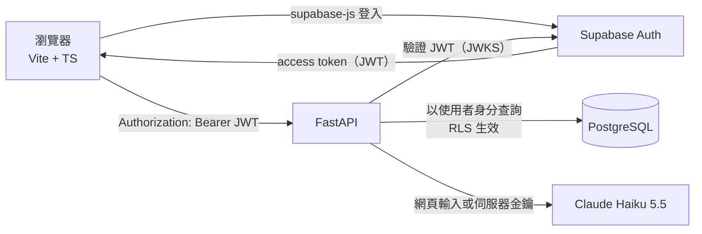
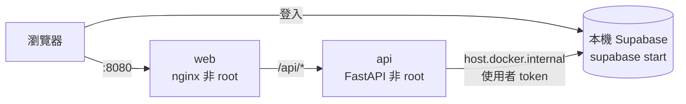

# 架構決策紀錄（ADR-001）：資料庫、登入與部署

- **日期**：2026-11-19
- **狀態**：已採用；**資料庫與登入的部分已由 ADR-002 取代**（改用純 PostgreSQL 與自建登入），以下保留當時的紀錄
- **對應**：PRD 待辦第 8 項；影響第 9 項（登入）、第 10 項（任務管理）、第 13 項（部署）

## 背景

目前前端為 Vite + TypeScript，後端為 Python FastAPI（jieba 斷詞、Anthropic SDK）。沒有資料庫，AI 建議的快取與限流只存在單一程序的記憶體。PRD 指定 Supabase（Auth／PostgreSQL／RLS）、Vercel 部署與 docker-compose 一鍵啟動。

## 決定

| 項目         | 決定                                                                                |
| :----------- | :---------------------------------------------------------------------------------- |
| 資料庫與登入 | Supabase：Auth（Email／密碼、Magic Link）、PostgreSQL、Row Level Security           |
| 後端         | 保留 Python FastAPI，不改寫成 TypeScript                                            |
| 開發環境     | 本機 Supabase CLI（Docker），不連雲端專案                                           |
| 部署         | 先只做本機 docker-compose；雲端平台（Vercel Python Functions 或 Railway）之後再決定 |

## 資料流

## 原則

1. **RLS 是最後一道防線**：FastAPI 以「使用者的 JWT」存取資料庫，讓 RLS 依 `auth.uid()` 過濾；不以 service role 讀寫使用者資料。service role 金鑰不進前端，也不用於一般請求。
2. **未登入一律拒絕**：所有業務資料表啟用 RLS 且不給 `anon` 任何 policy（PRD 4.2）。
3. **Mock Dataset 規則寫進資料庫約束**：`data_source` 只能是 `mock_dataset`、`is_synthetic` 只能是 `true`、`post_url` 必須是 `mock://threads/@` 開頭，從資料層防止混入真實資料（規格書第 4 節規則 1、2、3、8）。
4. **金鑰不落地**：使用者在網頁輸入的 Anthropic 金鑰只存在瀏覽器分頁，永不寫入資料庫。
5. **快取改用資料庫**：PRD 的 24 小時快取以 `analysis_tasks` 的 `completed_at` 判斷，取代記憶體快取；AI 結果存於 `analysis_summaries.strategy_insights`，天然依使用者隔離。

## 登入實作（PRD 待辦第 9 項，2026-11-20）

- **前端**：`/login`（`login.html`）提供 Email／密碼登入、建立帳號與 Magic Link；supabase-js 使用 PKCE，Magic Link 帶回的一次性 code 換成 session 後立即從網址移除。登入後依 `?next=` 返回原頁，`next` 只接受站內路徑，防止被利用導向外部網站。
- **頁面保護**：首頁確認 session 前不顯示內容；沒有 session 就導向 `/login`。API 回 401 時清除本機 session，以 `?reason=expired` 回登入頁並提示「登入階段已過期」。其他分頁登出時，此分頁也會跟著回到登入頁。
- **後端**：FastAPI 以 JWKS 驗證 access token（只接受非對稱演算法），未登入回 401；AI 端點的限流改為依使用者計算。
- **設定**：前端只拿到 publishable key（`VITE_SUPABASE_PUBLISHABLE_KEY`）；後端只需要 `SUPABASE_URL`，不需要任何 Supabase 密鑰。本機 Magic Link 信件寄到 mailpit（`http://127.0.0.1:54324`）。

## 任務管理實作（PRD 待辦第 10 項，2026-11-20）

- **資料存取**：FastAPI 以使用者的 access token 加 publishable key 呼叫 PostgREST，所有讀寫經過 RLS；後端程式不自行加 `user_id` 條件做權限判斷，也不需要任何 Supabase 密鑰。
- **交易寫入**：資料庫函式 `save_analysis_results`（`security invoker`）在同一交易內替換貼文與彙總並把任務標為 `completed`，重跑不會出現只刪不寫的中間狀態。
- **同步執行**：合成資料生成與分析通常 1 秒內完成，所以在請求內同步執行，各階段狀態仍寫回資料庫；程序中途結束時，任務在超過 3 分鐘後被標為 `failed`（依 `started_at`，重跑時更新）。
- **快取**：24 小時快取依（使用者, 帳號, 篇數）查 `completed_at`；AI 建議成功後存入 `strategy_insights`，原本程序內的記憶體快取已移除。
- **前端**：首頁新增「我的分析任務」列表（檢視、重新執行、刪除，刪除前以 `<dialog>` 確認）與「強制重新分析」選項；網址以 `?task=<id>` 記錄目前報告。

## 多帳號比較（PRD 待辦第 12 項，2026-11-20）

- **頁面**：`/compare`（`compare.html`），需登入；只列出本人已完成的任務，勾選 2～4 個後並排比較，網址以 `?tasks=id1,id2` 記錄選擇。
- **不新增後端**：前端以既有的 `GET /api/tasks/{id}` 讀回各任務報告（RLS 保證只讀得到本人的任務），在 `src/compare/compareMetrics.ts` 以純函式計算比較指標。
- **指標**：平均按讚、回覆、轉發與字數（後端統計）、互動率、發文頻率（篇數 ÷ 發文期間週數）、主力貼文長度（篇數最多的字數區間）、最佳貼文類型（平均互動最高）；每列最高者以文字標章「最高」標示，不只靠顏色。
- **匯出**：CSV（UTF-8 BOM、防公式注入）與 JSON，每列都帶 `data_source = mock_dataset`、`is_synthetic = true`，檔名含 `mock`。

## 本機部署（PRD 待辦第 13 項，2026-11-20）

- **啟動**：`supabase start -x …` → `cp .env.example .env` → `docker compose up --build` → `http://localhost:8080`。Supabase 仍由 Supabase CLI 管理，不放進這個 compose。
- **映像檔**：`docker/api.Dockerfile`（uv 安裝正式相依、Python 3.12 slim、非 root、內建健康檢查 `/api/health`）；`docker/web.Dockerfile`（bun 建置後交給 `nginx-unprivileged`）。金鑰不寫進映像檔，`.dockerignore` 排除 `.env`；前端建置只接受 `sb_publishable_` 開頭的金鑰。
- **容器加固**：兩個服務都是唯讀檔案系統（只開 tmpfs）、`cap_drop: ALL`、`no-new-privileges`；API 不對外開埠，網頁只綁定 `127.0.0.1`。
- **容器內的網址**：容器以 `host.docker.internal` 連 Supabase，但 token 的 `iss` 是瀏覽器使用的 `127.0.0.1` 網址，因此以 `SUPABASE_JWT_ISSUER` 另外指定。
- **安全標頭**（nginx，`docker/nginx/security-headers.inc.template`）：嚴格 CSP（`script-src 'self'`，不允許任何行內腳本、樣式或 `eval`；`connect-src` 只多開 Supabase 網址）、`X-Frame-Options: DENY`、`nosniff`、`Referrer-Policy`、`Permissions-Policy`、`Cross-Origin-Opener-Policy`。API 自己的回應另有 `default-src 'none'` 的 CSP 與 `no-store`。HSTS 待部署到 HTTPS 時加上。
- **快取**：`/assets/` 檔名含雜湊，快取一年；HTML 一律 `no-cache`，更新後立即生效。

## 可觀測性與 E2E（PRD 待辦第 15 項，2026-11-20）

- **結構化日誌**（`api/threadsinsightapi/observability.py`）：一行一筆 JSON，欄位採白名單（只收基本型別，`token`、`email`、`content` 等欄位名稱直接丟棄）。middleware 為每個請求產生 `request_id`，同時寫入日誌與 `X-Request-ID` 標頭；外部傳入的值只接受安全字元，避免日誌注入。
- **事件**：`http.request`（不含查詢字串）、`task.created／completed／failed／cache_hit／rerun`（含生成種子與各階段耗時）、`llm.call`（狀態、耗時、token 用量，不含提示內容）、`auth.rejected`、`db.unavailable`。容器內關閉 uvicorn 的存取紀錄（含查詢字串），由應用程式統一記錄。
- **E2E**（`e2e/`，Playwright）：每個測試自建帳號並在結束後以本機 secret key 刪除（只允許本機網址，key 從 `supabase status` 讀取、不寫入檔案）；共用 fixture 自動檢查 JavaScript 錯誤與 CSP 違規。可對開發伺服器或 docker compose（`E2E_BASE_URL`）執行。

## 雲端部署：Railway（2026-11-20）

部署在 Railway 專案 `threadsinsight`，所有自有服務都與 GitHub `main` 分支同步。

| 服務        | 來源                          | 說明                                                            |
| :---------- | :---------------------------- | :-------------------------------------------------------------- |
| `web`       | `docker/web.Dockerfile`       | nginx：提供三個頁面並轉送 `/api`；公開網域                      |
| `api`       | `docker/api.Dockerfile`       | FastAPI；不對外開放，只透過私有網路由 `web` 轉送                |
| `migrate`   | `docker/migrate.Dockerfile`   | 每次部署套用尚未執行的 `db/migrations/`，執行完即結束           |
| `floorplan` | `docker/floorplan.Dockerfile` | 架構圖匯出檔（`docs/floorplan/index.html`）的靜態網站；公開網域 |
| `Postgres`  | Railway 官方 PostgreSQL       | 資料庫；只走私有網路                                            |

- **與 GitHub 同步**：四個自有服務都連到 `main` 分支，並設定監看路徑，推上 GitHub 後只重新部署有變動的服務。
- **私有網路**：`web` 以 `API_UPSTREAM`（`api.railway.internal:8000`）轉送；nginx 以 resolver 在請求時解析位址。Railway 私有網路走 IPv6、健康檢查走 IPv4，所以 API 由 `api/serve.py` 建立同時接受兩者的 socket（`PORT=8000`）。
- **資料庫遷移不走公開網路**：Postgres 的公開 TCP 入口不加密，因此遷移由 `migrate` 服務在私有網路內執行，版本記錄在 `public.schema_migrations`。
- **架構圖更新方式**：重新產生架構圖後執行 `node floorplan/serve.mjs --export docs/floorplan/index.html`，推上 GitHub 即自動更新線上版。
- **歷程**：最初在 Railway 上自架 Supabase（社群範本，約 10 個服務）。因費用考量，使用者決定刪除，改用 Railway 官方 Postgres 與自建登入（ADR-002）。

## ADR-002：改用純 PostgreSQL 與自建登入（2026-11-20）

- **狀態**：已採用，取代 ADR-001 中「Supabase：Auth、PostgreSQL、RLS」的決定。
- **背景**：自架 Supabase 需要約 10 個常駐服務，費用與維護負擔都高；使用者決定只用一個 PostgreSQL，本機也不再跑資料庫測試。

| 項目     | 決定                                                     |
| :------- | :------------------------------------------------------- |
| 資料庫   | Railway 官方 PostgreSQL（同專案、私有網路）              |
| 登入     | 自建 Email＋密碼；不驗證信箱，沒有 Magic Link 與忘記密碼 |
| 資料隔離 | 保留資料庫 RLS                                           |
| 測試     | 本機只跑單元測試（資料庫以假實作取代）；E2E 對線上版執行 |

**設計**

- **RLS 的生效方式**：後端以資料庫擁有者帳號連線，但每個業務交易一開始就 `SET LOCAL ROLE threadsinsight_app`，並以 `set_config('app.user_id', …, true)` 帶上目前使用者；政策以 `current_app_user()` 比對 `user_id`。受限角色不是表格擁有者，所以 RLS 一定生效；它也沒有 `users`、`sessions` 的權限，讀不到密碼雜湊。
- **帳號與登入狀態**：`users`（Email、scrypt 雜湊）與 `sessions`（cookie 隨機值的 SHA-256、到期時間）只由後端以擁有者身分存取。登入狀態放在 `HttpOnly`、`Secure`、`SameSite=Strict` 的 cookie，網頁上的 JavaScript 讀不到；登出、刪帳號時在伺服器端作廢。
- **跨站請求**：cookie 會自動附帶，因此會修改資料的請求若帶著其他網站的 `Origin` 一律拒絕；`SameSite=Strict` 是第二層防護。nginx 以 `$http_host`（含埠號）轉送 Host，讓比對在本機與線上都正確。
- **前端**：移除 supabase-js；登入頁直接呼叫 `/api/auth/*`；CSP 的 `connect-src` 只剩 `'self'`。
- **帳號刪除**：新增「刪除自己的帳號」，任務、貼文、報告與登入狀態連帶刪除；E2E 也用它清除測試帳號。

**取捨**

- **少了寄信功能**：不驗證信箱、沒有 Magic Link 與忘記密碼。接上寄信服務（例如 Resend）後可補上。
- **本機沒有資料庫測試**：RLS 與 SQL 的正確性改由線上 E2E 驗證；開發時另以臨時 Postgres 容器確認過遷移與存取層的 SQL。單元測試用假實作，無法發現 SQL 寫錯，修改資料表或查詢後務必跑線上 E2E。
- **自管登入的責任**：密碼雜湊、登入狀態、限流、跨站檢查都要自己維護，不能依賴外部服務的更新。

## 取捨與風險

- **不改寫成 TypeScript**：省下重寫 jieba 斷詞與整套分析的成本，代價是前後端兩種語言。
- **部署**：最後選擇 Railway 容器（見上方「雲端部署」），AI 端點最壞約 95 秒，容器沒有函式執行時間上限的問題。
- **登入狀態不放在 localStorage**：改為 httpOnly cookie 後，就算頁面有 XSS 也讀不到登入憑證；所有動態內容仍一律經 `escapeHtml`，並以不允許行內腳本的 CSP 再加一層防護。
- **本機 Supabase 需要 Docker**：首次 `supabase start` 需下載多個映像檔；只啟用需要的服務以減少下載量。
