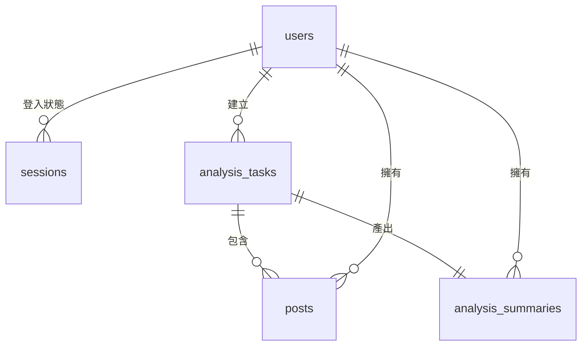

# 資料表說明

ThreadsInsight 的資料存在一個 PostgreSQL 資料庫（部署在 Railway）。這份文件說明有哪些資料表、各存什麼、彼此怎麼關聯，以及誰能看哪些資料。

實際建立資料表的 SQL 在 [db/migrations/20261120120000_initial_schema.sql](../db/migrations/20261120120000_initial_schema.sql)。部署時由 `migrate` 服務自動套用，套用過的版本記在 `schema_migrations` 表。

> 考題原本要求 `supabase/migrations/`。本專案最後沒有用 Supabase，改用一般的 PostgreSQL（原因見 [architecture.md](architecture.md) 的 ADR-002），所以資料表檔放在 `db/migrations/`。

## 一張圖看懂

- 一個使用者可以有多個分析任務，每個任務有多篇貼文和一份彙總結果。
- 刪除使用者時，他的登入狀態、任務、貼文、彙總結果會一起刪除；刪除任務時，該任務的貼文和彙總結果也會一起刪除。

## 五張資料表

### 1. `users`：會員帳號

| 欄位            | 型別          | 說明                                             |
| :-------------- | :------------ | :----------------------------------------------- |
| `id`            | `uuid`        | 會員編號，自動產生                               |
| `email`         | `text`        | 登入用的 Email，不可重複，一律存小寫             |
| `password_hash` | `text`        | 密碼經過雜湊後的結果（scrypt），**不存原始密碼** |
| `created_at`    | `timestamptz` | 註冊時間                                         |

### 2. `sessions`：登入狀態

使用者登入後，瀏覽器會拿到一個隨機的登入憑證（cookie）。資料庫只存它的雜湊值，就算資料庫外洩，也拿不到能直接冒用的憑證。

| 欄位         | 型別          | 說明                                   |
| :----------- | :------------ | :------------------------------------- |
| `token_hash` | `text`        | 登入憑證的 SHA-256 雜湊值（64 個字元） |
| `user_id`    | `uuid`        | 屬於哪個會員                           |
| `created_at` | `timestamptz` | 登入時間                               |
| `expires_at` | `timestamptz` | 到期時間（登入後 7 天）                |

### 3. `analysis_tasks`：分析任務

使用者每輸入一次帳號按「開始分析」，就是一個任務。

| 欄位              | 型別          | 說明                                                                                                 |
| :---------------- | :------------ | :--------------------------------------------------------------------------------------------------- |
| `id`              | `uuid`        | 任務編號                                                                                             |
| `user_id`         | `uuid`        | 誰建立的                                                                                             |
| `target_username` | `text`        | 要分析的 Threads 帳號（整理成小寫、不含 `@`）                                                        |
| `target_url`      | `text`        | 使用者原本輸入的帳號或網址                                                                           |
| `requested_count` | `int`         | 要幾篇貼文（1～50，預設 30）                                                                         |
| `status`          | `text`        | 進度：等待中 `pending`、產生資料中 `generating`、分析中 `analyzing`、完成 `completed`、失敗 `failed` |
| `data_source`     | `text`        | 固定是 `mock_dataset`（示範資料）                                                                    |
| `source_note`     | `text`        | 為什麼用示範資料的說明                                                                               |
| `post_count`      | `int`         | 實際收錄的貼文數                                                                                     |
| `error_message`   | `text`        | 失敗時的原因                                                                                         |
| `created_at`      | `timestamptz` | 建立時間                                                                                             |
| `started_at`      | `timestamptz` | 這次開始執行的時間（重跑會更新），用來判斷有沒有卡住                                                 |
| `completed_at`    | `timestamptz` | 完成時間，用來判斷 24 小時快取                                                                       |

### 4. `posts`：貼文明細

每個任務的每一篇貼文一列，包含原始數字和清理後算出來的欄位。

| 欄位                                                        | 型別          | 說明                                                               |
| :---------------------------------------------------------- | :------------ | :----------------------------------------------------------------- |
| `id`                                                        | `uuid`        | 紀錄編號                                                           |
| `task_id`                                                   | `uuid`        | 屬於哪個任務                                                       |
| `user_id`                                                   | `uuid`        | 屬於哪個會員（多存一份，讓權限檢查更快）                           |
| `platform_post_id`                                          | `text`        | 貼文編號，同一個任務內不可重複                                     |
| `post_url`                                                  | `text`        | 一定是 `mock://threads/@帳號/post/編號`，不會出現真的 Threads 網址 |
| `is_synthetic`                                              | `boolean`     | 一定是 `true`（示範資料）                                          |
| `published_at`                                              | `timestamptz` | 發文時間                                                           |
| `content`                                                   | `text`        | 貼文內文                                                           |
| `views_count`                                               | `bigint`      | 瀏覽數；可以是空的，代表「未公開」                                 |
| `likes_count`                                               | `int`         | 讚數                                                               |
| `replies_count`                                             | `int`         | 回覆數                                                             |
| `reposts_count`                                             | `int`         | 轉發＋引用數                                                       |
| `engagement_score`                                          | `numeric`     | 加權互動分（讚 + 2 × 回覆）                                        |
| `engagement_group`                                          | `text`        | 互動分組：`high`、`medium`、`low`                                  |
| `engagement_tier`                                           | `text`        | 產生資料時預設的互動層級（用來檢查分組是否合理）                   |
| `char_count`、`hashtag_count`、`mention_count`、`url_count` | `int`         | 字數、hashtag 數、mention 數、網址數                               |
| `media_type`                                                | `text`        | 純文字 `text_only` 或含圖片 `image`                                |
| `post_type`                                                 | `text`        | 貼文類型：含圖片、含連結、含 hashtag、含 mention、純文字           |
| `topic`                                                     | `text`        | 主題：職場、生活、科技、觀點、其他                                 |
| `sentiment`                                                 | `text`        | 語氣：正面、中性、負面                                             |
| `has_question`、`has_cta`                                   | `boolean`     | 有沒有提問、有沒有邀請大家互動                                     |

### 5. `analysis_summaries`：彙總分析結果

每個任務一份，存報告畫面需要的統計結果。內容比較複雜，所以用 JSON 格式（`jsonb`）存。

| 欄位                   | 說明                                              |
| :--------------------- | :------------------------------------------------ |
| `task_id`、`user_id`   | 屬於哪個任務、哪個會員（一個任務只有一份）        |
| `overview_metrics`     | 總覽數字：平均讚、回覆、轉發、互動數等            |
| `top_posts`            | 互動分前 5 名的貼文                               |
| `distributions`        | 發文時段、文字長度、貼文類型、主題的分布          |
| `keywords_hashtags`    | 常見關鍵字與 hashtag                              |
| `nlp_cluster_analysis` | 高、中、低三組的內容特徵分析                      |
| `strategy_insights`    | 3 點策略觀察；使用 AI 建議後，AI 的結果也存在這裡 |
| `created_at`           | 產出時間                                          |

## 誰能看哪些資料

- **每個人只能看到、修改自己的任務、貼文和彙總結果。** 這條規則由資料庫本身把關（PostgreSQL 的 Row Level Security），不是只靠程式判斷。就算程式哪裡寫漏了，資料庫也不會交出別人的資料。
- 做法：伺服器每次存取資料前，會先切換成一個權限受限的身分（`threadsinsight_app`），並告訴資料庫「現在是哪個會員」，資料庫就只放行這個會員自己的資料。
- 看別人的任務會得到「找不到」（404），不會透露那個任務是否存在。
- `users` 和 `sessions` 這兩張存密碼和登入狀態的表，受限身分完全碰不到，只有伺服器處理登入時能存取。
- 沒登入的人什麼都看不到。

## 資料庫自己擋下的錯誤資料

為了確保「只會出現示範資料」，以下規則直接寫在資料庫裡，不符合的資料存不進去：

- 任務的 `data_source` 只能是 `mock_dataset`。
- 貼文的 `is_synthetic` 只能是 `true`，網址只能是 `mock://threads/@…` 開頭。
- 帳號名稱只能有小寫英文、數字、`.`、`_`，最長 30 個字。
- 篇數只能是 1～50；讚數、回覆數等不能是負數。
- 任務狀態是「完成」時一定要有完成時間，反過來也一樣。

## 重跑任務時怎麼更新

重跑時，舊的貼文和彙總結果要換成新的。這件事由資料庫裡的 `save_analysis_results` 一次完成：刪掉舊資料、寫入新資料、把任務標成完成，三個步驟要嘛全部成功，要嘛全部不算，不會出現「舊的刪了、新的沒寫進去」的情況。這個函式也照樣受「只能動自己的資料」的規則限制。
