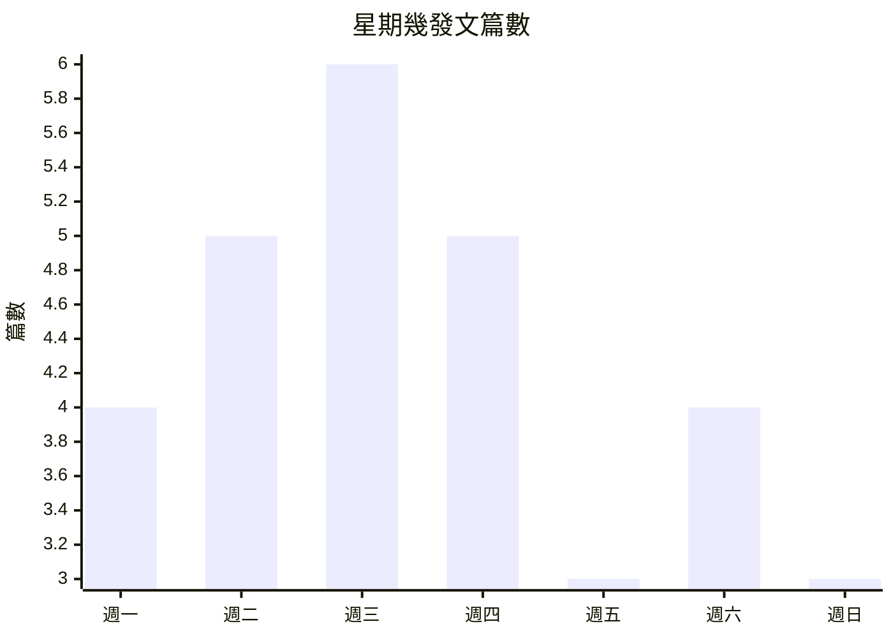
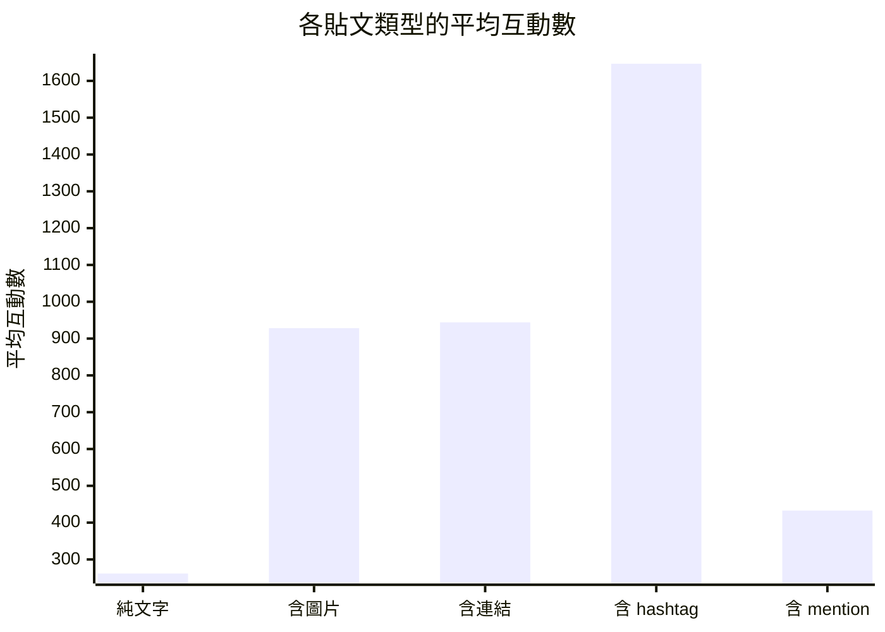

# @demo_user 貼文分析報告（範例）

> 示範資料（Mock Dataset），非 @demo_user 的真實貼文。產生時間：2026-11-20T16:53:58+08:00。

## 總覽指標

| 指標 | 數值 |
| :--- | ---: |
| 收錄篇數 | 30 |
| 平均讚數 | 879 |
| 平均回覆數 | 81.7 |
| 平均轉發數 | 45 |
| 平均互動數（讚＋回覆＋轉發） | 1,005.7 |
| 有公開瀏覽數的貼文 | 27 篇 |
| 清理時移除的重複／無效貼文 | 0／0 篇 |

## Top 5 貼文

依加權互動分（讚 + 2 × 回覆）排序。

| 名次 | 發文時間 | 互動分 | 讚 | 回覆 | 瀏覽 | 內容 | 網址 |
| ---: | :--- | ---: | ---: | ---: | ---: | :--- | :--- |
| 1 | 2026-11-03 20:53 | 3306 | 2908 | 199 | 101,780 | 說「不」其實是在保護自己真正想說「好」的事情。 想聽聽大家的做法。 #心態 #思… | mock://threads/@demo_user/post/12 |
| 2 | 2026-10-07 20:18 | 3262 | 3136 | 63 | 87,808 | 密碼管理器用了半年，再也回不去每個網站同一組密碼的日子。 #數位生活 #AI… | mock://threads/@demo_user/post/29 |
| 3 | 2026-11-08 20:54 | 3201 | 2731 | 235 | 98,316 | 自己煮飯一個月，省下的錢剛好買了一直想要的咖啡機。 記錄一下。 #生活 #日常… | mock://threads/@demo_user/post/8 |
| 4 | 2026-10-20 23:51 | 3178 | 2556 | 311 | 35,784 | 團隊合作最怕的不是意見不同，而是大家都不說。 共勉之。 延伸閱讀：https:/… | mock://threads/@demo_user/post/21 |
| 5 | 2026-10-21 12:02 | 3088 | 2360 | 364 | 54,280 | 說「不」其實是在保護自己真正想說「好」的事情。 #思考… | mock://threads/@demo_user/post/20 |

## 圖表

## 內容策略觀察

1. **使用 hashtag 的貼文互動較高**：14 篇平均互動 1696，高於整體平均 1006（69%）。建議：每篇加上 1–2 個與主題相符的 hashtag。
2. **「職場」主題最受歡迎**：5 篇平均互動 1402，高於整體平均 1006（39%）。建議：以「職場」為主軸規劃系列內容，其他主題可嘗試與它結合。
3. **附外部連結的貼文互動較低**：6 篇平均互動 640，低於整體平均 1006（36%）。建議：把連結移到第一則留言，讓貼文本身完整可讀。

以上是規則引擎依全部貼文算出的相關性觀察，不代表因果；網站上可再用 Claude Haiku 產生 AI 建議。
