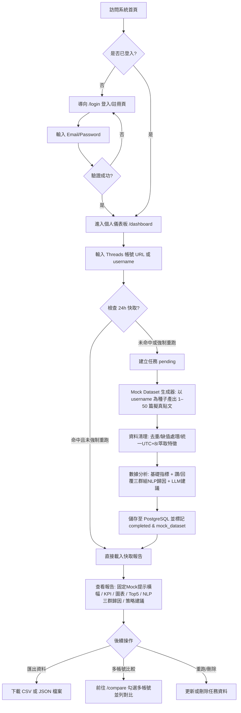

# 產品需求規格書（PRD）：ThreadsInsight

**文件版本**：v1.3（2026-11-19：貼文數範圍改為 1–50 篇〔預設 30〕並定義小樣本行為；新增「全部貼文明細」與響應式（RWD）需求）  
**前版**：v1.2（2026-11-19：全面統一為 Mock Dataset 合成擬真資料規則，移除多層爬取與備援切換邏輯）  
**狀態**：待確認（確認範圍、優先級與驗收標準後進入開發）  
**技術架構**：Vite + TypeScript 前端 + Python FastAPI 後端（合成資料生成器、jieba NLP 分析模組、LLM 建議） + PostgreSQL（RLS）與自建 Email／密碼登入 + LLM API（Claude Haiku 5.5，`claude-haiku-5-5`）。部署於 Railway（網站、API、PostgreSQL），與 GitHub 同步（見 `docs/architecture.md` ADR-001、ADR-002）

---

## 1. 產品目標與問題定義

### 1.1 問題定義

內容營運團隊在評估自營或競品 Threads 帳號的發文表現時，面臨以下痛點：

1. **外部資料取得受限**：經實測，Threads 未登入公開頁面受驗證牆限制（HTTP 401），官方 API 亦申請受限且僅能讀取自有帳號，無法用於分析任意公開帳號，導致開發與測試缺乏穩定的結構化貼文來源。
2. **缺乏量化與質化歸因**：難以系統性評估「發文時段」、「字數長度」、「媒體/貼文類型」與「主題關鍵字」對互動率的影響，也缺乏針對高/中/低互動貼文的深度內容成因分析。
3. **跨帳號比較困難**：缺乏統一儀表板進行多帳號基準（Benchmark）對比與資料匯出。

### 1.2 產品目標

打造一個支援會員登入與資料隔離的 Web 數據分析工具。使用者輸入任意 Threads 帳號名稱（`username`）或帳號 URL 後，系統**一律使用 Mock Dataset 規則（合成擬真資料）**，依據帳號種子確定性生成 1–50 篇（預設 30 篇）近期貼文，執行完整的資料清理、三群組 NLP 分群歸因分析，並產出視覺化儀表板、內容策略洞察與 LLM 優化建議。

### 1.3 目標使用者與使用情境

- **目標使用者**：社群內容編輯、品牌行銷企劃、數據分析師、自媒體經營者。
- **核心使用情境**：
  - **情境 A（單一帳號模擬健檢）**：輸入指定 Threads 帳號，檢視系統依據該帳號種子生成的近 1–50 篇（預設 30 篇）擬真貼文互動表現、最佳發文時間、Top 5 貼文與每篇貼文的完整明細。
  - **情境 B（高/中/低互動歸因分析）**：透過按讚與回覆指標將貼文分為三群，針對各群組抽樣 3～5 篇貼文進行 NLP 語意與結構分析，驗證「高互動與低互動貼文的內容特徵差異」。
  - **情境 C（多帳號橫向比較與匯出）**：勾選 2 個以上已分析的帳號進行指標對比，並匯出 CSV / JSON 報表供週報或測試使用。

### 1.4 專案不處理範圍（Out of Scope）

- **不實作線上網頁爬蟲**：不使用 Playwright、headless browser 或 GraphQL 抓取真實 Threads 網頁資料。
- **不串接官方 Threads API**：不進行 Meta / Threads Graph API 申請與線上呼叫。
- **不混用真實與合成資料**：所有任務一律使用合成擬真資料，絕不混入真實貼文。
- **不提供社群自動化操作**：不提供自動排程發文、自動按讚或自動回覆功能。

---

## 2. 功能描述

### F1. 使用者註冊、登入與權限控管

- **目的**：確保分析任務與數據具備個人工作區隔離，未登入者無法存取儀表板。
- **觸發條件**：使用者訪問網站首頁、`/login` 或嘗試進入受保護路由（`/dashboard`、`/tasks`、`/compare`）。
- **輸入資料**：Email、Password（不驗證信箱；Magic Link 與忘記密碼待接上寄信服務後再提供）。
- **處理流程**：後端自建 Email／密碼登入（密碼以 scrypt 雜湊保存，登入狀態存於 httpOnly cookie）；頁面載入時向後端確認登入狀態，未登入者強制重導向至 `/login`。
- **輸出結果**：建立/驗證使用者 Session，跳轉至個人分析儀表板總覽頁。
- **使用者可見狀態**：登入表單驗證提示、載入中狀態、登入錯誤訊息、右上角顯示目前登入帳號與登出按鈕。

### F2. Threads 分析任務管理（建立、查看、重跑、刪除）

- **目的**：讓使用者能管理針對不同 Threads 帳號發起的分析任務。
- **觸發條件**：使用者在任務列表點擊「新增分析」、「重跑任務」、「檢視報告」或「刪除任務」。
- **輸入資料**：Threads 帳號名稱（如 `@demo_user` 或 `demo_user`）或完整 URL（如 `https://www.threads.com/@demo_user`）、目標貼文數（1–50 的整數，預設 30 篇）。
- **處理流程**：
  - **建立**：正規化帳號名稱 $\rightarrow$ 檢查 24 小時內是否有同帳號快取 $\rightarrow$ 若無快取或選擇強制更新，建立 `pending` 任務並觸發 Mock Dataset 生成與分析管線。
  - **重跑**：保留原任務 ID，清除舊貼文與彙總快取，重新執行合成資料生成與分析流程。
  - **刪除**：確認後刪除該任務及其關聯之貼文與彙總數據。
- **輸出結果**：更新任務列表狀態（`pending` $\rightarrow$ `generating` $\rightarrow$ `analyzing` $\rightarrow$ `completed` / `failed`）。
- **使用者可見狀態**：任務進度條/狀態標籤、固定資料來源標記（`Mock Dataset 合成資料`）、操作按鈕與確認彈窗。

### F3. 資料取得（一律使用 Mock Dataset 規則）與資料清理

- **目的**：穩定、合規且可重現地產出 1–50 篇（預設 30 篇）結構化擬真貼文資料，並執行標準化清理流程。
- **觸發條件**：分析任務進入 `generating` 階段。
- **輸入資料**：正規化後的 Threads `username` 與目標數量（1–50 的整數，預設 30）。
- **處理流程**：
  1. **合成資料生成（一律採用 Mock Dataset 規則，詳見 `threadsinsightapi.md` §4）**：
     - **採用原因**：實測未登入狀態下 `threads.com` GraphQL 回傳 HTTP 401，且官方 API 申請受限無法讀取他人帳號；為確保開發順暢與合規性，系統**一律使用合成擬真資料**。
     - **確定性種子（Deterministic Seed）**：以正規化後的 `username` 作為亂數種子，確保同一帳號每次生成的貼文內容、時間與互動數據完全一致，利於測試與 24 小時快取比對。
     - **防誤認與透明標示**：
       - 整批任務固定標記 `data_source = 'mock_dataset'`，並於 `source_note` 記錄原因說明。
       - 每篇貼文皆帶 `is_synthetic: true` 標記。
       - 貼文 URL 統一使用不可點擊的偽協議格式 `mock://threads/@{username}/post/{n}`，避免產生指向真實 `threads.com` 的假連結。
       - 文字內容使用通用社群範例主題（涵蓋職場、生活、科技、觀點討論等），不冒用目標帳號真實語氣或聲稱該貼文為對方所發。
     - **互動層級分布保證**：生成器以每 10 篇為一組，固定配置 3 篇高互動、4 篇中互動、3 篇低互動，三層級的 `likes_count` 範圍互不重疊。因此篇數 $\ge 10$ 時保證高、中、低三層級各至少 3 篇；篇數 $< 10$ 時不保證涵蓋三層級（見 F4 小樣本規則）。部分貼文 `views_count` 依真實情境設為 `null` 以測試缺失值處理。
     - **前綴一致性**：同一帳號一律先生成 50 篇再取前 N 篇，因此較少篇數的結果必為較多篇數結果的前綴（例如 1 篇的結果等於 50 篇結果的第 1 篇）。
  2. **資料清理**：
     - **去重**：依據 `post_url` 或 `platform_post_id` 驗證並移除重複貼文。
     - **缺失值處理**：數值欄位（如設為 `null` 的曝光數）於計算總瀏覽數時自動排除，互動率計算採用替代分母公式或加權互動分；非核心計數缺失補 `0`，文字缺失補空字串。
     - **時區統一**：將所有時間戳統一轉換為 `Asia/Taipei (UTC+8)` ISO-8601 格式。
     - **特徵萃取**：計算純文字字元數（`char_count`）、`hashtag_count`、`mention_count`、`url_count` 及媒體/貼文類型（純文字、圖片/媒體、含連結、含 hashtag、含 mention）。
- **輸出結果**：寫入 `posts` 資料表的標準化貼文紀錄。
- **使用者可見狀態**：生成進度提示（如「已生成並清理 30/30 篇合成貼文」）、報告頂端永久顯示「示範資料（Mock Dataset），非 @{username} 的真實貼文」橫幅（**不可關閉**）。

### F4. 互動分群與 NLP 深度分析引擎

- **目的**：依按讚與回覆指標將貼文分群，並以一致的 NLP 方法剖析各群組的成功與失敗原因。
- **觸發條件**：資料清理完成，任務進入 `analyzing` 階段。
- **輸入資料**：該任務已清理的 1–50 篇貼文資料。
- **處理流程**：
  1. **基礎統計指標計算**：計算平均 like / reply / repost、加權互動分（$\text{likes} + 2 \times \text{replies}$）排行 Top 5 貼文（不足 5 篇時列出全部並以「Top N」標示；不用互動率排序，因部分貼文瀏覽數為 `null` 無法計算，且互動率會讓低瀏覽貼文排名虛高）、星期/小時發文分布矩陣、文字長度區間（`0-50`、`51-100`、`101-200`、`201-400`、`401+`）與互動關聯性、高頻關鍵字/Hashtag、貼文類型分布。
  2. **三層互動分群（Clustering）**：
     - 計算每篇貼文的「核心互動分」：$\text{Score} = \text{likes} + 2 \times \text{replies}$（突顯按讚與回覆指標）。
     - 依百分位數將所有貼文分為三組：高互動組（Top 30%）、中互動組（Middle 40%）、低互動組（Bottom 30%）。
  3. **一致化 NLP 內容歸因（每組抽樣 3～5 篇）**：
     - 從三組中各選取最具代表性的 3～5 篇貼文（高互動取最高、中互動取中位數附近、低互動取最低）。
     - 套用完全一致的 NLP 分析管線（TF-IDF / Jieba 中文斷詞關鍵詞權重 + 句型結構/情緒極性/行動呼籲 CTA 偵測 + 主題分類模型），產出每組的共同語言特徵與成功/失敗歸因報告。
     - **小樣本規則**：每組實際抽樣數為 $\min(5, \text{該組篇數})$；某組篇數為 0 時標示「樣本不足」並略過該組歸因。總篇數 $< 10$ 時，報告於三群組區塊顯示「樣本數少於 10 篇，分群結果僅供參考」。
  4. **策略觀察與 LLM 建議生成**：
     - 彙整數據與 NLP 結果，呼叫 LLM（Claude Haiku 5.5）產出「3 點核心內容策略觀察」與「具體可執行的優化建議（含改寫範例）」。
     - LLM 建議由獨立端點 `GET /api/ai-strategy` 提供：報告先顯示規則引擎產出的 3 點觀察，LLM 結果回來後再替換，使報告不受 LLM 耗時影響（見非功能需求第 2 點的 15 秒目標）。
- **輸出結果**：將彙總 JSON 寫入 `analysis_summaries` 資料表，任務狀態更新為 `completed`。

### F5. 分析報告儀表板、多帳號比較與資料匯出

- **目的**：視覺化呈現分析結果，支援多帳號基準對比與原始/彙總資料下載。
- **觸發條件**：使用者點擊已完成的分析任務，或進入 `/compare` 頁面。
- **輸入資料**：`analysis_summaries` 與 `posts` 資料表內容。
- **處理流程**：
  - **單一報告頁**：報告開頭顯示「示範資料（Mock Dataset），非 @{username} 的真實貼文」不可關閉橫幅（位於報告最上方、不隨捲動黏著，避免遮擋內容）；渲染 KPI 總覽卡片（收錄篇數、總互動、總瀏覽、平均互動、最佳類型）、Top 5 貼文表格、至少 3 張互動圖表（發文時段熱力圖/長條圖、文字長度與互動關係散佈/長條圖、貼文類型與主題分布圖）、三群組 NLP 成因對照卡片、3 點策略觀察與 LLM 建議。
  - **全部貼文明細**：報告列出該任務的每一篇貼文（N 篇即 N 張卡片），依發文時間由新到舊排列。每張卡片顯示編號、發文時間（`Asia/Taipei`）、貼文類型與互動層級標籤、**完整內文**（不截斷、保留換行），以及讚、回覆、轉發、瀏覽（`null` 顯示「未公開」）與單篇互動率；`mock://` 網址僅以純文字呈現，不可點擊。報告標題區提供「查看全部 N 篇貼文」錨點連結。
  - **響應式版面（RWD）**：見非功能需求第 7 點。
  - **多帳號比較頁**：勾選 2～4 個已完成任務，並列比較平均互動率、發文頻率、主力貼文長度與最佳類型。
  - **資料匯出**：前端或 API Route 將貼文明細（含 `is_synthetic: true` 欄位）與彙總指標轉換為 `.csv`（含 UTF-8 BOM 確保 Excel 開啟不亂碼）或 `.json` 檔案觸發下載。
- **輸出結果**：互動式 Web 報告頁面、下載的 `.csv` / `.json` 檔案。

---

## 3. 使用者流程（User Flow）

---

## 4. 資料與權限設計（PostgreSQL Schema & RLS）

### 4.1 資料表設計（ER 關聯與欄位規格）

所有資料表皆建置於 PostgreSQL，並透過 `user_id` 關聯至 `users`（帳號表，由後端自行管理，見 ADR-002）。

#### 1. `profiles`（使用者資料表）

| 欄位名稱       | 資料型別      | 必填 | 預設值 / 約束             | 說明             |
| :------------- | :------------ | :--: | :------------------------ | :--------------- |
| `id`           | `uuid`        |  是  | `PK, FK -> auth.users.id` | 使用者唯一識別碼 |
| `email`        | `text`        |  是  | `UNIQUE`                  | 使用者註冊信箱   |
| `display_name` | `text`        |  否  | `null`                    | 顯示名稱         |
| `created_at`   | `timestamptz` |  是  | `now()`                   | 建立時間         |

#### 2. `analysis_tasks`（分析任務表）

| 欄位名稱          | 資料型別      | 必填 | 預設值 / 約束                                                                       | 說明                                                            |
| :---------------- | :------------ | :--: | :---------------------------------------------------------------------------------- | :-------------------------------------------------------------- |
| `id`              | `uuid`        |  是  | `PK, gen_random_uuid()`                                                             | 任務唯一 ID                                                     |
| `user_id`         | `uuid`        |  是  | `FK -> profiles.id (ON DELETE CASCADE)`                                             | 任務擁有者 ID                                                   |
| `target_username` | `text`        |  是  | `NOT NULL`                                                                          | 正規化後的 Threads 帳號（不含 `@`）                             |
| `target_url`      | `text`        |  是  | `NOT NULL`                                                                          | 原始輸入或標準化帳號 URL                                        |
| `status`          | `text`        |  是  | `'pending'`                                                                         | `pending` / `generating` / `analyzing` / `completed` / `failed` |
| `data_source`     | `text`        |  是  | `'mock_dataset'`                                                                    | 固定為 `'mock_dataset'`（合成擬真資料）                         |
| `source_note`     | `text`        |  是  | `'Scraping blocked (HTTP 401) & API unavailable; using deterministic Mock Dataset'` | 資料來源技術說明                                                |
| `post_count`      | `int4`        |  是  | `0`                                                                                 | 實際收錄有效貼文數                                              |
| `error_message`   | `text`        |  否  | `null`                                                                              | 失敗時的錯誤原因                                                |
| `created_at`      | `timestamptz` |  是  | `now()`                                                                             | 建立時間                                                        |
| `completed_at`    | `timestamptz` |  否  | `null`                                                                              | 完成時間（用於快取判斷）                                        |

#### 3. `posts`（貼文明細資料表）

| 欄位名稱           | 資料型別      | 必填 | 預設值 / 約束                                 | 說明                                              |
| :----------------- | :------------ | :--: | :-------------------------------------------- | :------------------------------------------------ |
| `id`               | `uuid`        |  是  | `PK, gen_random_uuid()`                       | 貼文紀錄 ID                                       |
| `task_id`          | `uuid`        |  是  | `FK -> analysis_tasks.id (ON DELETE CASCADE)` | 所屬分析任務 ID                                   |
| `user_id`          | `uuid`        |  是  | `FK -> profiles.id (ON DELETE CASCADE)`       | 冗餘儲存以加速 RLS 驗證                           |
| `platform_post_id` | `text`        |  是  | `UNIQUE(task_id, platform_post_id)`           | 合成貼文識別碼（防重複）                          |
| `post_url`         | `text`        |  是  | `NOT NULL`                                    | 固定為 `mock://threads/@{username}/post/{n}` 格式 |
| `is_synthetic`     | `boolean`     |  是  | `true`                                        | 逐筆標示為合成資料（固定為 `true`）               |
| `published_at`     | `timestamptz` |  是  | `NOT NULL`                                    | 統一轉換為 `Asia/Taipei` 的發文時間               |
| `content`          | `text`        |  是  | `''`                                          | 貼文純文字內容（通用範例主題）                    |
| `views_count`      | `int8`        |  否  | `null`                                        | 曝光/瀏覽數（部分模擬未公開情況設為 `null`）      |
| `likes_count`      | `int4`        |  是  | `0`                                           | 按讚數                                            |
| `replies_count`    | `int4`        |  是  | `0`                                           | 回覆數                                            |
| `reposts_count`    | `int4`        |  是  | `0`                                           | 轉發與引用數（repost + quote）                    |
| `engagement_score` | `numeric`     |  是  | `0`                                           | 加權互動分（`likes + 2 * replies`）               |
| `engagement_group` | `text`        |  否  | `null`                                        | `high` / `medium` / `low`                         |
| `char_count`       | `int4`        |  是  | `0`                                           | 文字長度                                          |
| `hashtag_count`    | `int4`        |  是  | `0`                                           | Hashtag 數量                                      |
| `mention_count`    | `int4`        |  是  | `0`                                           | Mention（`@`）數量                                |
| `url_count`        | `int4`        |  是  | `0`                                           | 外部連結數量                                      |
| `post_type`        | `text`        |  是  | `'text_only'`                                 | 貼文類型（純文字/含圖片/含連結/含標籤等）         |

#### 4. `analysis_summaries`（彙總分析結果表）

| 欄位名稱               | 資料型別      | 必填 | 預設值 / 約束                                         | 說明                                            |
| :--------------------- | :------------ | :--: | :---------------------------------------------------- | :---------------------------------------------- |
| `id`                   | `uuid`        |  是  | `PK, gen_random_uuid()`                               | 彙總 ID                                         |
| `task_id`              | `uuid`        |  是  | `UNIQUE, FK -> analysis_tasks.id (ON DELETE CASCADE)` | 對應分析任務                                    |
| `user_id`              | `uuid`        |  是  | `FK -> profiles.id (ON DELETE CASCADE)`               | 任務擁有者 ID                                   |
| `overview_metrics`     | `jsonb`       |  是  | `'{}'`                                                | 總互動、平均 like/reply/repost、最佳類型等      |
| `top_posts`            | `jsonb`       |  是  | `'[]'`                                                | 加權互動分前 5 篇貼文明細                       |
| `distributions`        | `jsonb`       |  是  | `'{}'`                                                | 發文時段分布、文字長度分布、類型與主題分布      |
| `keywords_hashtags`    | `jsonb`       |  是  | `'[]'`                                                | 常見關鍵字與 Hashtag 統計                       |
| `nlp_cluster_analysis` | `jsonb`       |  是  | `'{}'`                                                | 高/中/低三組（各 3-5 篇）NLP 關鍵特徵與成因分析 |
| `strategy_insights`    | `jsonb`       |  是  | `'[]'`                                                | 3 點內容策略觀察與 LLM 優化建議                 |
| `created_at`           | `timestamptz` |  是  | `now()`                                               | 產出時間                                        |

### 4.2 權限控管（Row Level Security, RLS）

- 所有 4 張資料表皆強制開啟 `ALTER TABLE ... ENABLE ROW LEVEL SECURITY;`。
- **存取原則**：僅允許已驗證使用者（`auth.uid()`）對 `user_id = auth.uid()`（`profiles` 表則為 `id = auth.uid()`）的資料列執行 `SELECT`、`INSERT`、`UPDATE`、`DELETE`。
- **未登入者（`anon` role）**：完全拒絕讀取或寫入任何業務資料表。

---

## 5. 例外情境與容錯處理（Edge Cases & Error Handling）

| 例外情境                                   | 偵測方式                                                           | 系統處理與 Retry / 降級行為                                                                                                                    | 使用者可見錯誤/提示訊息                                                                       |
| :----------------------------------------- | :----------------------------------------------------------------- | :--------------------------------------------------------------------------------------------------------------------------------------------- | :-------------------------------------------------------------------------------------------- |
| **1. 登入失敗 / Session 過期**             | 登入失敗或登入狀態（cookie）無效                                   | 阻擋受保護 API 與頁面存取，清除無效 Cookie 並導向 `/login`。                                                                                   | 「帳號或密碼錯誤，請重新輸入」或「登入階段已過期，請重新登入」。                              |
| **2. 輸入帳號格式不合法**                  | 正則驗證失敗（含非法字元、空白或非 Threads 網址格式）              | 阻擋提交並提示正確輸入格式，不建立無效任務。                                                                                                   | 「請輸入有效的 Threads 帳號名稱（如 @demo_user）或網址。」                                    |
| **3. 貼文數超出範圍或非整數**              | 前端 `min=1`／`max=50` 驗證；API 參數驗證（`count` 非 1–50 整數）  | 前端阻擋提交並標示欄位錯誤；API 回傳 `400` 與錯誤訊息，不建立任務、不自動修正數值。                                                            | 「請輸入 1 到 50 之間的整數。」                                                               |
| **4. 外部平台限制（爬蟲遭擋 / API 受限）** | 系統預設策略（已於實測階段驗證未登入 GraphQL 回傳 HTTP 401）       | **一律直接採用確定性 Mock Dataset 規則**產出擬真資料，並於任務與 UI 全面標示來源，不執行線上爬取。                                             | 報告頂端固定顯示不可關閉橫幅：「示範資料（Mock Dataset），非 @{username} 的真實貼文」。       |
| **5. 貼文部分欄位缺失（模擬曝光數隱藏）**  | 生成器依真實情境將部分貼文 `views_count` 設為 `null`               | 總瀏覽數僅加總有效值，互動率改以「互動總數 / 有效曝光」或「加權互動分」排序；計數欄位缺失補 `0`。                                              | 指標卡片附註：「部分貼文未公開顯示瀏覽數，已自動排除於平均瀏覽計算。」                        |
| **6. LLM 或外部 API 逾時**                 | 請求超過 30 秒 Timeout 或回傳 5xx                                  | 自動 Retry 2 次；若仍失敗，改由規則引擎（Rule-based Template）產出基礎策略觀察，確保分析報告不中斷。                                           | 「AI 深度建議生成逾時，目前已顯示系統規則引擎產出之基礎策略觀察。」                           |
| **7. 重複提交相同分析任務**                | 同使用者在 24 小時內對同一 `target_username` 已有 `completed` 任務 | 預設直接回傳快取結果（節省重複計算時間）；若使用者勾選「強制重新分析」，則重新執行生成與分析管線（因採用確定性種子，同帳號資料仍具可重現性）。 | 「已為您載入 24 小時內的最新分析快取（更新時間：{timestamp}），點擊『重新分析』可重新計算。」 |
| **8. 分析管線非同步中斷**                  | 任務停留在 `generating` / `analyzing` 超過 3 分鐘                  | 任務標記為 `failed` 並寫入 `error_message`，開放使用者點擊「重跑」。                                                                           | 「分析過程發生非預期錯誤，請點擊『重新執行』再試一次。」                                      |

---

## 6. 驗收標準（Acceptance Criteria）

### AC-1：使用者驗證與資料隔離

- **Given** 使用者尚未登入系統  
  **When** 嘗試直接訪問 `/dashboard` 或呼叫 `/api/tasks`  
  **Then** 頁面自動重導向至 `/login`，且 API 回傳 `401 Unauthorized`。
- **Given** 使用者 A 與使用者 B 皆已登入並各自建立分析任務  
  **When** 使用者 A 查詢任務列表或嘗試透過 API 讀取使用者 B 的 `task_id`  
  **Then** 僅能看到使用者 A 自己的任務，讀取 B 的資料回傳空陣列或 `403`/`404`（RLS 生效）。

### AC-2：確定性 Mock Dataset 生成與資料清理

- **Given** 使用者已登入並輸入任意合法格式的 Threads 帳號（如 `demo_user`）  
  **When** 建立分析任務並執行完成  
  **Then** 任務標記為 `data_source = 'mock_dataset'`，資料庫 `posts` 表中該任務存有與指定數量相同（1–50，未指定時為 30）的不重複貼文，每筆皆帶有 `is_synthetic = true` 與 `mock://threads/@demo_user/post/{n}` 格式網址；若以相同帳號重複生成，產出的貼文內容與互動數值完全一致（可重現），且所有 `published_at` 皆為統一時區（`+08:00`）。
- **Given** 使用者輸入貼文數 `1`  
  **When** 建立分析任務並執行完成  
  **Then** 任務恰好存有 1 篇貼文，且該篇與同帳號 50 篇結果的第 1 篇完全相同（前綴一致性）。
- **Given** 使用者輸入貼文數 `0`、`51` 或非整數  
  **When** 嘗試提交  
  **Then** 前端阻擋提交並顯示「請輸入 1 到 50 之間的整數。」；若繞過前端直接呼叫 API，回傳 `400` 且不建立任務。

### AC-3：三群組互動分類與一致化 NLP 歸因

- **Given** 任務已生成並清理完成 $\ge 10$ 篇貼文  
  **When** 系統執行數據分析模組  
  **Then** 所有貼文依據按讚與回覆指標被劃分為「高互動」、「中互動」、「低互動」三群；每群各自抽樣 3～5 篇貼文並套用相同的 NLP 特徵萃取與歸因方法，產出包含「共同關鍵詞、語言結構特徵、成功/失敗原因」的結構化分析結果。
- **Given** 任務只有 $< 10$ 篇貼文  
  **When** 系統執行數據分析模組  
  **Then** 各組抽樣數為 $\min(5, \text{該組篇數})$，篇數為 0 的組標示「樣本不足」並略過歸因，報告顯示「樣本數少於 10 篇，分群結果僅供參考」，且分析流程不得因此失敗。

### AC-4：視覺化儀表板、Mock 標示、LLM 建議與匯出

- **Given** 任務狀態為 `completed`  
  **When** 使用者開啟該任務的分析報告頁  
  **Then** 報告開頭顯示不可關閉的「示範資料（Mock Dataset），非 @{username} 的真實貼文」橫幅（不隨捲動黏著、不遮擋內容），並完整顯示：(1) 總覽指標卡片、(2) Top 5 貼文表格（不足 5 篇時為 Top N）、(3) 至少 2 張以上互動圖表、(4) 三群組 NLP 歸因分析、(5) 3 點內容策略觀察與 LLM 優化建議、(6) 全部貼文明細。
- **Given** 任務共有 N 篇貼文（1 ≤ N ≤ 50）  
  **When** 使用者點擊「查看全部 N 篇貼文」  
  **Then** 頁面捲動至「全部貼文（N 篇）」區塊，恰好顯示 N 張貼文卡片，每張含完整內文與讚、回覆、轉發、瀏覽、互動率；畫面上沒有任何固定元素遮擋內容。
- **Given** 使用者以 320、375、390、430、768、820、1024、1280、1440、1920 px 寬度或手機橫放開啟報告頁  
  **When** 頁面載入完成並捲動至底部  
  **Then** 頁面無水平捲動，任何貼文卡片內容不溢出，且所有互動元件觸控區域 $\ge 44\text{px}$。
- **When** 使用者點擊「匯出 CSV」與「匯出 JSON」  
  **Then** 瀏覽器成功下載對應格式檔案，檔案內含 `is_synthetic` 標記與完整貼文字段且無亂碼。

### AC-5：多帳號比較

- **Given** 使用者擁有至少 2 個已完成的分析任務  
  **When** 在多帳號比較頁面勾選 2 個帳號進行對比  
  **Then** 畫面並列呈現兩帳號的平均按讚、平均回覆、平均轉發、平均字數與最佳表現貼文類型差異。

---

## 7. 非功能需求（Non-Functional Requirements）

1. **安全性（Security）**：
   - 嚴格啟用 PostgreSQL RLS：後端每個交易以受限角色並帶上目前使用者 ID 執行，政策只放行本人的資料。
   - 環境變數（`DATABASE_URL`、`ANTHROPIC_API_KEY`）僅限伺服器端讀取，絕不暴露於前端 Bundle；本機以 `.env`（由 `.env.example` 複製，已列入 `.gitignore`）設定。
   - 使用者可在網頁輸入自己的 Anthropic API 金鑰：只存於該分頁的 `sessionStorage`（關閉即清除），以請求標頭送至後端代為呼叫，不得放入網址、記錄於日誌或寫入資料庫；回應設為 `Cache-Control: no-store`。
   - 對使用者輸入的帳號名稱與 URL 進行嚴格白名單字元過濾，防範注入攻擊。
2. **效能與快取（Performance & Caching）**：
   - 同一帳號 24 小時內預設命中資料庫快取，查詢回應時間 $< 500\text{ms}$。
   - 單次新任務生成與 NLP/LLM 分析總耗時控制在 15 秒內。
3. **可用性與容錯（Reliability）**：
   - 外部 LLM API 實作指數退避 Retry（最多 2 次）與規則引擎降級（Graceful Degradation），確保報告生成 100% 可用。
4. **合規與透明性（Compliance & Transparency）**：
   - 全面採用確定性合成資料（Mock Dataset），不違反平台服務條款（ToS），並於 UI 橫幅、資料欄位（`is_synthetic`）與 `README.md` 清楚揭露資料來源與限制。
5. **測試與可觀測性（Testing & Logging）**：
   - 關鍵模組（確定性 Mock 生成器、資料清理、指標計算、三群組 NLP 分群、匯出格式轉換）具備自動化單元測試（Jest / Vitest 或 Pytest）。
   - 記錄結構化執行日誌（包含生成種子、任務階段耗時與 LLM 呼叫狀態）。
6. **部署與一鍵啟動（Deployment & Packaging）**：
   - 前端與 API 可無縫部署至 Vercel（附 `vercel.json` 設定）。
   - 提供 `Dockerfile` / `docker-compose.yml` 與一鍵啟動指令（如 `npm run setup && npm run dev` 或 `docker compose up`），並附上完整 `.env.example`。
7. **響應式設計（RWD）**：
   - 支援 320 px 以上的手機、平板（直放與橫放）、筆電與桌機（至 2560 px），任何寬度皆不得出現頁面水平捲動。
   - 版面以內容寬度自動決定欄數（CSS Grid `auto-fill` / `auto-fit`），元件依自身寬度調整排版（CSS 容器查詢），不依賴固定裝置斷點：
     - 全部貼文卡片：卡片最小寬度 20rem，依可用寬度自動為 1–3 欄（實測：手機直放 1 欄；手機橫放與平板直放 2 欄；平板橫放、筆電與桌機 3 欄）。
     - Top 5 表格：容器寬度 $< 760\text{px}$ 時改為卡片式堆疊並以 `::before` 補上欄位名稱。
     - 分析表單：容器寬度 $\ge 640\text{px}$ 時橫向排列，否則直向堆疊。
   - 支援瀏海／圓角螢幕安全區域（`viewport-fit=cover` 與 `env(safe-area-inset-*)`）；僅在支援懸停的裝置套用 hover 樣式；互動元件觸控區域 $\ge 44\text{px}$。
   - 尊重使用者偏好：`prefers-reduced-motion` 時停用平滑捲動與過渡動畫；字級使用 `rem` 與 `clamp()`，瀏覽器放大至 200% 時不得遺失內容。
